<h1 align="center">MCMinelab Web</h1>

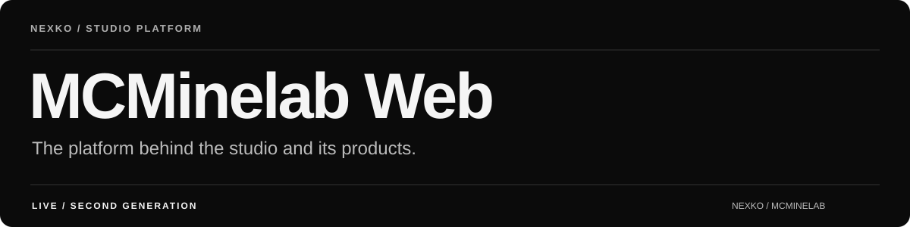

The second-generation web platform for **MCMinelab**, an independent Minecraft studio. It brings the studio's public identity, editorial content and software products into one web application.

**Live at MCMinelab.** Designed and developed by **Nexko**. This repository is a public case study and feedback hub; application sources and operational systems remain private.

## Explore the platform

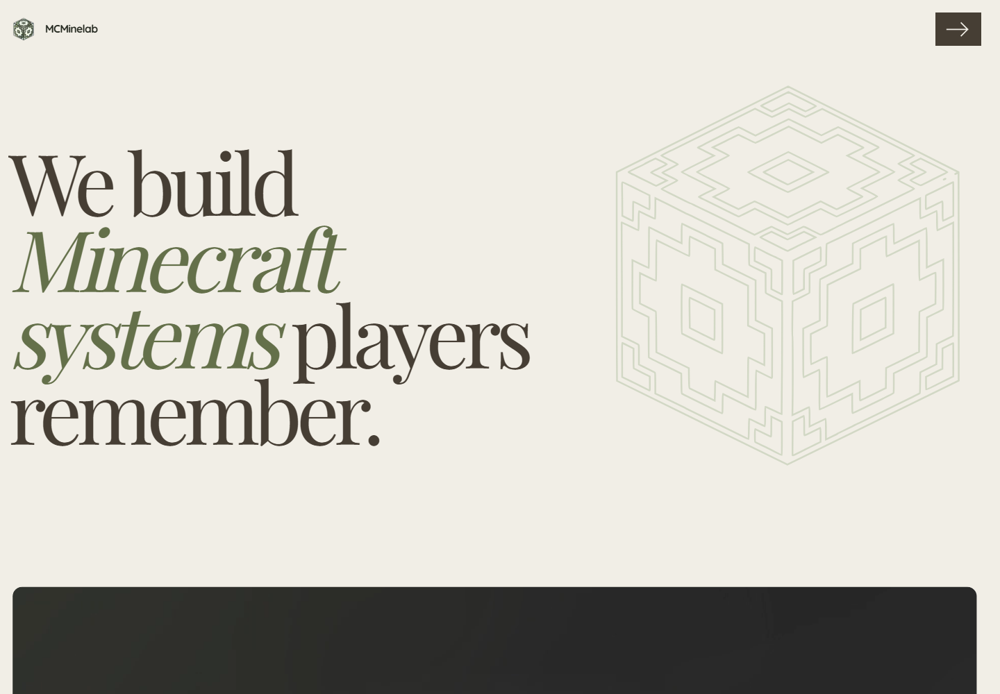

## From studio website to product platform

### Present the studio

Services, selected work, contact routes and a coherent visual identity introduce the studio and its production network. Contributor credits stay attached to the work presented on the website.

### Publish and explain products

The catalogue connects software such as ModernHDV to product pages, edition information, downloads and documentation. Guides and MDX content provide an editorial layer alongside the application.

### Support customers and operations

Accounts, authentication, product checkout and entitlements connect the public experience to digital delivery. Private administration supports content and product publishing.

## Product catalogue

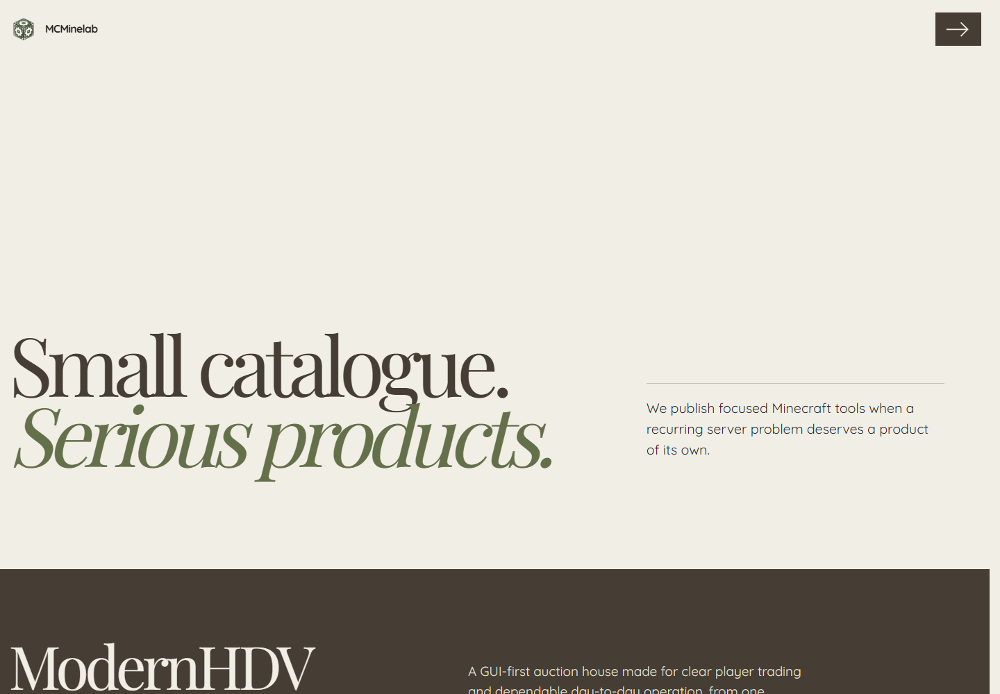

## Documentation as part of the product

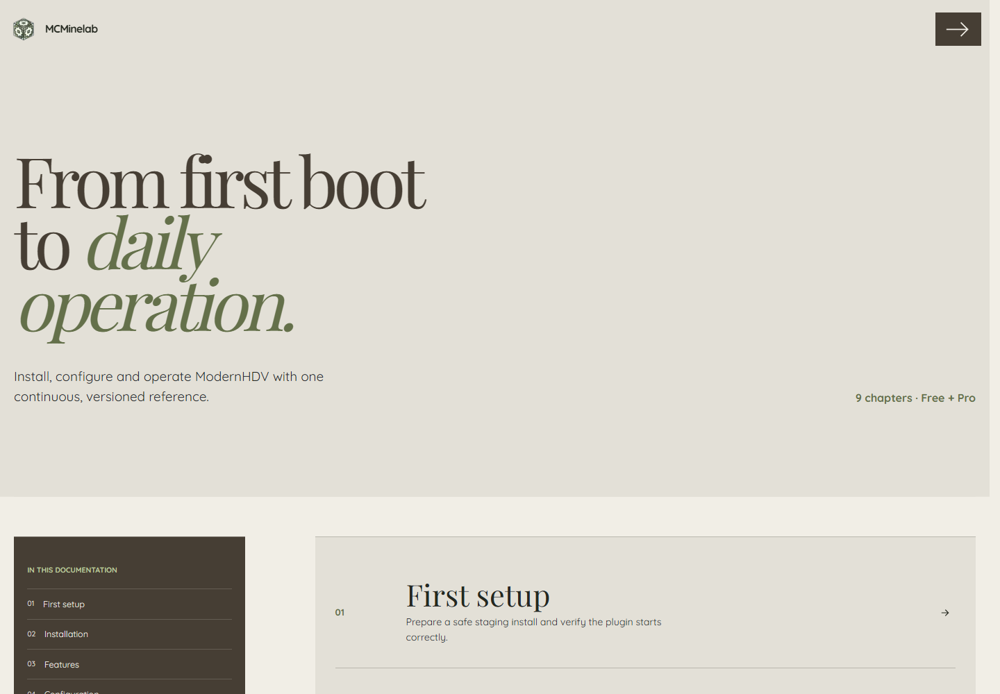

The documentation is accessible alongside the product journey, from initial setup to day-to-day operation.

## Engineering

Built with Next.js, React and TypeScript, with Prisma / MySQL for application data, Better Auth for accounts, MDX for editorial content, Stripe for checkout and Cloudflare R2 for digital files. The design uses self-hosted typography.

The platform replaces the former WordPress website with a dedicated application. The engineering notes describe the main domains and the separation between public content, authenticated accounts and private operations.

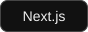
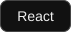
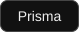
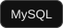
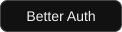
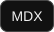

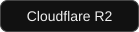

## Feedback and contact

Use Issues for reproducible website bugs and feature requests. Product-specific ModernHDV bugs belong in its dedicated public tracker. For commissions, partnerships or a private account / order question, use the website's contact route.

## Project ownership

Designed, developed and operated by **Nexko / MCMinelab**. This repository presents the platform; it is not a source distribution or a mirror of private customer or administration data.
